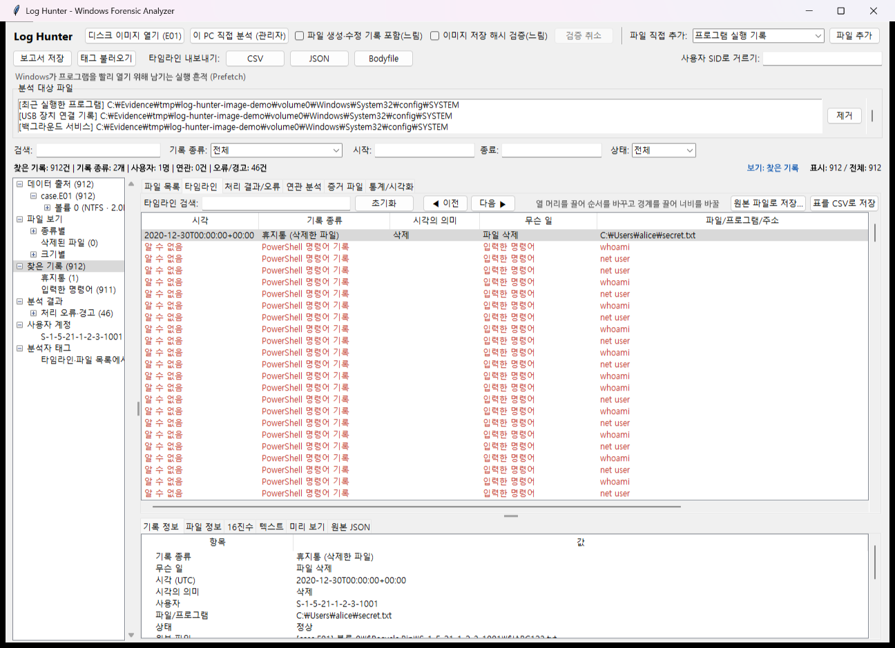
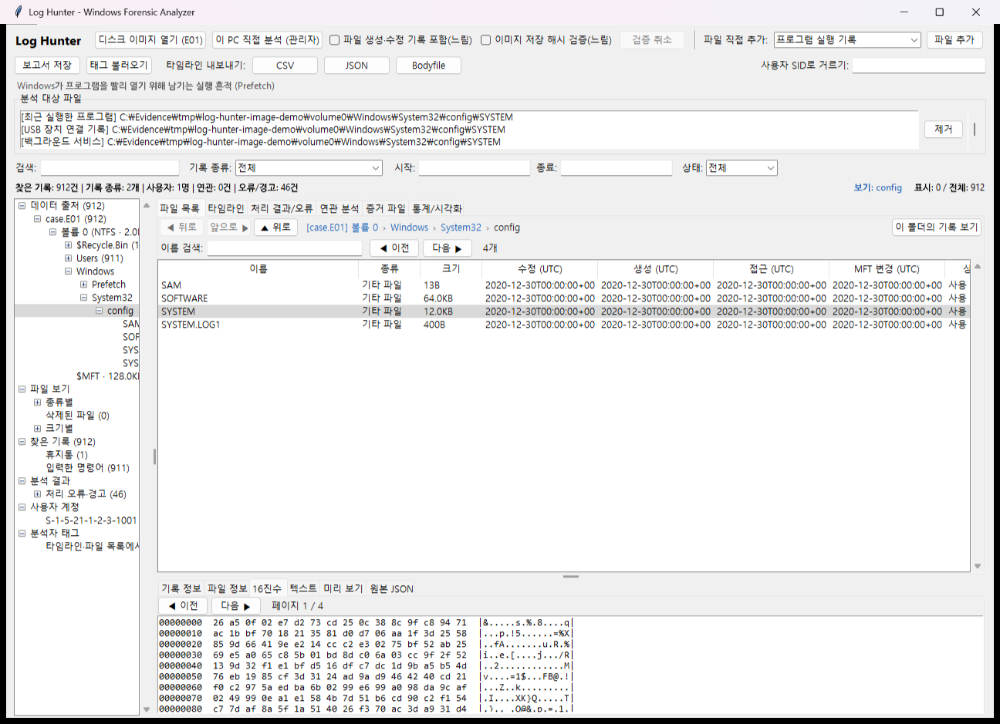
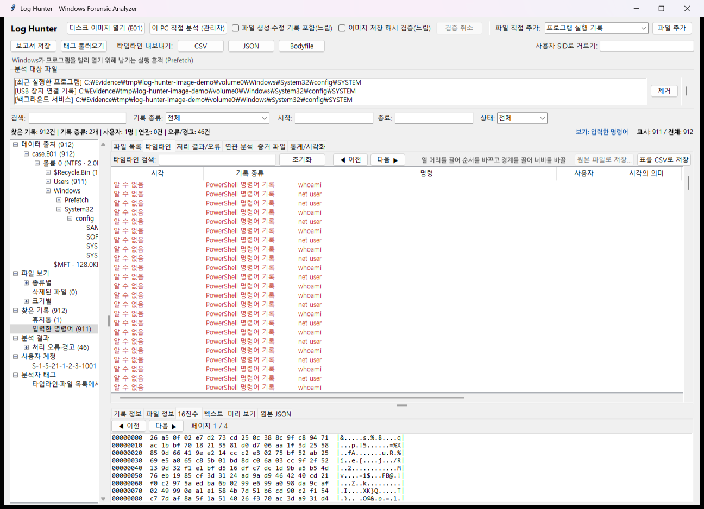

# Log Hunter

Windows 포렌식 아티팩트(레지스트리, Prefetch, 이벤트 로그, 브라우저 기록 등)를 **읽기 전용**으로 분석해
타임라인과 보고서를 만드는 도구입니다. 디스크 이미지(E01·raw·고정 VHD)나 실행 중인 이 PC의 드라이브를 열면
필요한 파일을 알아서 꺼내 분석하고, 이미지 안의 폴더·파일도 탐색기처럼 볼 수 있습니다.
Python 3.11 이상, 표준 라이브러리만 사용합니다. 증거에서 나온 명령행·스크립트는 실행하지 않습니다.



## 설치·빌드

### 가장 쉬운 실행 (Windows)

Python 3.11 이상과 Tcl/Tk를 설치한 뒤 `run.bat`을 더블클릭하면 GUI가 열립니다.
cmd에서는 다음처럼 실행합니다.

```bat
run.bat
run.bat analyze --image "C:\Evidence\disk.E01" --output outputs\case01
run-live.bat
run-live.bat D:
test.bat
```

`run-live.bat`은 기본 시스템 드라이브를 직접 분석하며 UAC 관리자 권한 확인을 요청합니다.
`test.bat`은 저장소의 `outputs\test-temp`를 임시 폴더로 사용해 전체 테스트를 실행합니다.
다른 폴더에서도 bat의 전체 경로로 실행할 수 있고, 분석 입력·출력의 상대 경로는 호출한 폴더 기준입니다.
`py -3`를 먼저 찾고 없으면 `python`을 사용합니다. 더블클릭 실행에서 오류가 나면 Enter를 누를 때까지 창을 유지합니다.

Python 3.11 이상이 필요하며 런타임 패키지 의존성은 없습니다. 오프라인 분석과
압축 Prefetch 해제는 Windows·Linux·macOS에서 실행할 수 있습니다. 수집과
이 PC 직접 분석은 Windows 전용입니다. GUI에 필요한 Tkinter는 다음 명령으로 확인합니다.

```powershell
python -m tkinter
```

소스 폴더에서는 설치 없이 실행합니다.

```powershell
python -m log_hunter gui
python -m log_hunter analyze --input prefetch evidence/sample.pf --output outputs/case
```

설치하면 `log-hunter` 명령을 사용할 수 있습니다.

```powershell
python -m pip install .
log-hunter gui
log-hunter analyze --image evidence/disk.E01 --output outputs/image-case
```

표준 라이브러리 zipapp으로 프로그램을 단일 파일에 묶을 수 있습니다.
생성된 파일을 Python 3.11 이상이 있는 PC로 복사해 실행합니다. 빌드 산출물은 커밋하지 않습니다.

```powershell
python tools/build_pyz.py
python dist/log-hunter.pyz gui
python dist/log-hunter.pyz analyze --input prefetch evidence/sample.pf --output outputs/pyz-case
```

설치 후 입력 선택과 CLI 실행 방법은 [빠른 시작](#빠른-시작)을 따릅니다. 이 PC 분석은 관리자 권한이 필요합니다.

```powershell
python -m log_hunter analyze --image evidence/disk.E01 --output outputs/image-case
python -m log_hunter analyze --live C: --output outputs/live-case
python -m log_hunter collect file evidence/sample.bin outputs/collected/sample.bin
python -m log_hunter collect registry HKLM\SYSTEM outputs/collected/SYSTEM
python -m log_hunter collect eventlog System outputs/collected/System.evtx
python -m log_hunter collect browser "C:\Users\<user>\AppData\Local\Google\Chrome\User Data\Default\History" outputs/collected/chrome
```

| 기능 | 관리자 권한 |
| --- | --- |
| 오프라인 파일·이미지 분석 | 불필요 |
| 일반 파일 공유 읽기 | 대상 접근 권한 필요 |
| 이 PC 분석·잠긴 파일 직접 읽기·브라우저 수집 | 필요 |
| 레지스트리 저장 | 관리자와 백업 권한 필요 |
| 이벤트 로그 내보내기 | 채널 권한 필요, 보안 채널 등은 관리자 권장 |

수집은 ctypes로 Windows 시스템 API를 직접 호출하며 별도 컴파일 과정이 없습니다.
공유 읽기가 거부되면 직접 NTFS 볼륨 읽기로 대체합니다. 스냅샷 생성은 제거했습니다.
브라우저 DB·WAL·SHM은 한 볼륨 세션에서 읽지만 실행 중 원본이 바뀔 수 있으므로
시점 일관성을 보장하지 않으며 manifest에 `point_in_time_consistent: false`를 남깁니다.
수집 대상 파일을 덮어쓰지 않습니다. 기존 `collect --dll` 옵션은 제거했습니다.

테스트는 `python -m unittest discover -s tests`로 실행합니다. Tkinter가 없으면
Python 설치 관리자의 Tcl/Tk 구성 요소 또는 운영체제의 Tkinter 패키지를 설치합니다.
권한 오류가 나면 관리자 권한과 대상 파일·채널 접근 권한을 확인합니다. 백신이 볼륨 읽기를
막으면 조직의 보안 정책에 따라 허용 여부를 확인하거나 오프라인 이미지를 분석합니다.

## 빠른 시작

1. `python -m log_hunter gui`로 화면을 엽니다.
2. 입력에 맞는 버튼을 누릅니다.
   - **디스크 이미지 열기 (E01)**: E01·dd·고정 VHD 파일을 고릅니다.
   - **이 PC 직접 분석 (관리자)**: 지금 쓰는 PC의 드라이브를 읽습니다(관리자 권한 필요).
   - **파일 추가** / **폴더 추가**: 하이브·로그 같은 파일이나 수집 폴더를 고르면 기록 종류를 자동으로 알아내 목록에 넣습니다
     (인식 근거 표시).
   - 입력을 넣거나 목록에서 **제거**하면 바로 자동으로 분석합니다(따로 누를 버튼이 없습니다). 연달아 바꾸면 잠시 모았다가 한 번,
     분석 중에 또 바꾸면 이전 분석을 멈추고 새로 분석합니다. 진행률과 "분석 중"/"분석 완료"는 아래 상태 줄에 보입니다.
3. 왼쪽 트리에서 출처·기록 분류·사용자를 골라 타임라인을 좁혀 보고, **보고서 저장**으로 결과를 남깁니다.

같은 일을 명령으로 할 수 있습니다(PowerShell).

```powershell
python -m log_hunter analyze --image C:\Evidence\disk.E01 --output outputs\case01
```

## 기능별 사용법

### 디스크 이미지(E01) 분석

하이브 파일을 하나씩 고를 필요 없이 디스크 이미지를 통째로 넣으면, NTFS 볼륨에서
레지스트리 하이브(+LOG1/LOG2), Prefetch, 이벤트 로그, 휴지통, 최근 문서, 예약 작업,
브라우저 기록 등을 자동으로 꺼내 분석합니다. 실행 중인 PC의 파일이 잠겨 생기는
권한 오류도 이미지 분석에서는 발생하지 않습니다.

```powershell
python -m log_hunter analyze --image C:\Evidence\disk.E01 --output outputs\case03
python -m log_hunter analyze --image C:\Evidence\disk.dd --with-mft --output outputs\case04
```

- 지원 형식: E01(다중 세그먼트 E01/E02…), raw/dd(분할 .001/.002…), 고정 크기 VHD
- 파티션: MBR(확장 파티션 포함), GPT. BitLocker 볼륨은 감지 후 건너뜁니다(복호화된 이미지 필요).
- 미지원: Ex01/L01, 동적 VHD/VHDX, NTFS 압축·EFS 암호화 파일(경고로 표시)
- 꺼낸 파일은 `<output>\extracted`에, 원래 경로·MFT 레코드·SHA-256은 `image_manifest.json`에 기록됩니다.
- GUI에서는 **디스크 이미지 열기 (E01)** 버튼을 누르면 이미지가 바로 왼쪽 트리에 나타나고, 추출·분석은 뒤에서 이어집니다.

### 선택 실행: 이미지 해시 검증

```powershell
python -m log_hunter analyze --image C:\Evidence\disk.E01 --verify-image --output outputs\verified
```

E01의 압축을 푼 전체 미디어 바이트에서 MD5·SHA1·SHA256을 스트리밍 계산하고,
hash/digest 섹션의 저장값과 비교합니다. raw/dd는 같은 이름의 `.md5`·`.sha1`·`.txt`
보조 파일에 적힌 해당 이미지의 해시를 비교하며 없으면 계산값만 기록합니다.
이 결과는 `image_manifest.json`의 `verification`과 분석 진단에 남습니다.
일치·불일치·저장값 없음·읽기 실패·메타데이터 손상·취소를 구별하며,
MD5/SHA1 일치는 저장된 값과의 비교 결과이지 저장값 출처의 진위 확인은 아닙니다.
기본 분석에는 전체 해시 검증을 추가하지 않습니다. 실행 중인 `--live`에는 적용하지 않습니다.
GUI에서는 상단의 **이미지 저장 해시 검증(느림)**을 켜고 이미지를 열면 같은 검증을 하며, 진행률이 상태 줄에 보이고 **검증 취소**로 멈출 수 있습니다.
결과는 **증거 파일** 탭에 표시됩니다.

### 이 PC 직접 분석 (권한 오류 해결)

실행 중인 Windows는 레지스트리 하이브·이벤트 로그·Amcache 등을 잠가 두기 때문에 파일을
직접 고르면 권한 오류가 납니다. 이 기능은 관리자 권한으로 드라이브(`\\.\C:`)를 직접 읽어
NTFS에서 파일을 꺼내므로 잠금과 상관없이 복사됩니다. 이미지 분석과 같은 추출기를 씁니다.

```powershell
# 관리자 권한 PowerShell에서
python -m log_hunter analyze --live C: --output outputs\live01
```

- GUI의 **이 PC 직접 분석 (관리자)** 버튼은 관리자가 아니면 Windows 확인 창(UAC)을 띄워
  관리자 권한으로 다시 열고 바로 분석을 시작합니다. 파일을 직접 넣었다가 권한 오류가 나도 같은 안내가 뜹니다.
- 관리자 권한 없이 잠긴 파일을 읽는 방법은 Windows 보안상 없습니다.
- 실행 중에 읽으므로 몇 초 전 변경이 빠지거나 일부 파일이 어긋날 수 있습니다(경고로 표시).
  하이브는 LOG1/LOG2를 함께 꺼내 재적용합니다. 법적 증거용이면 이미지(E01) 분석을 권장합니다.
- BitLocker가 켜진 드라이브도 잠금 해제 상태라면 복호화된 내용으로 읽힙니다.

### 파일·폴더 자동 인식

GUI의 **파일 추가**·**폴더 추가**도 같은 규칙을 씁니다. 목록에는 파일마다 인식 근거가 붙습니다.
디스크 이미지는 이미지 분석으로 열지 묻습니다. 직접 고른 파일 중 종류를 알아내지 못한 것만 '파일 직접 추가'에서 고른
종류로 넣을지 묻습니다. 보조 파일(LOG1·-wal 등)만 있거나 지원하지 않는 파일은 이유를 보여 주고 넣지 않습니다.

```powershell
python -m log_hunter analyze --auto evidence/collection evidence/renamed.hiv --output outputs/auto-case
```

실행 전에 파일별 기록 종류·사용자 SID·인식 근거를 표시합니다.
NTUSER.DAT, SYSTEM, SOFTWARE는 관련된 여러 기록으로 연결하며 UsrClass.dat도 인식합니다.
이름이 바뀐 하이브는 헤더의 원래 이름과 루트 하위 키로 판별합니다.
수집 폴더는 이미지 추출과 같은 경로 규칙을 사용하고, 같은 수집 루트의 SOFTWARE
사용자 목록으로 SID를 연결합니다. 원본 옆의 LOG1/LOG2와 SQLite 보조 파일은 기존 분석 복구 경로를 사용합니다.
보조 파일만 있거나 지원하지 않는 하이브·이미지는 이유를 표시합니다.
E01은 첫 세그먼트로 묶고 raw는 부트 시그니처, 고정 VHD는 푸터로 확인합니다.
이미지는 한 번에 하나씩 분석하며 일반 파일 입력과 함께 처리하지 않습니다.
`--auto`와 `--input`/`--image`/`--live`는 함께 사용할 수 없습니다.

### 파일 직접 지정

```powershell
python -m log_hunter analyze --input userassist C:\Evidence\NTUSER.DAT --input bam C:\Evidence\SYSTEM --input prefetch C:\Evidence\Prefetch --output outputs\case02
python -m log_hunter analyze --input history C:\Evidence\History --input psreadline C:\Evidence\ConsoleHost_history.txt --output outputs\case03
```

지원 입력 이름(26종): `amcache`, `bam`, `cache`, `defender`, `evtx`, `history`, `jumplist`, `lnk`, `mft`, `mru`, `rdp`, `thumbcache`,
`network`, `prefetch`, `psreadline`, `recyclebin`, `run`, `services`, `shellbag`, `srum`, `startup`, `taskcache`, `tasks`, `usb`,
`userassist`, `wlan`. 이름이 틀리면 지원 목록과 함께 오류를 보여 줍니다.
`--sid`로 확인된 대상 SID를, `--environment target_environment.json`으로 수집 대상의 확인된 환경변수만 제공합니다.
분석 PC의 환경변수로 대체하지 않습니다. 오류가 있어도 다음 입력을 처리하며, 오류가 하나라도 있으면 CLI는 종료 코드 1을 반환합니다.

### 백신 탐지·조치 이벤트

Microsoft-Windows-Windows Defender 공급자의 1116/1117 이벤트를 탐지/조치 기록으로 구분합니다.
위협 이름·ID·탐지 사용자·대상 표현·조치 이름·오류 코드를 상세 정보에 보존합니다.
허용(Allow)도 조치에 포함되므로 1117만으로 격리·제거 성공이나 위협 실행을 확정하지 않습니다.
시각은 EVTX 레코드 FILETIME이며 payload 탐지 시각은 시간대 미검증 원문으로 구별합니다.
여러 파일·컨테이너를 가리키는 대상 표현은 단일 파일 경로로 추정하지 않습니다.
`--input defender C:\Evidence\Defender`로 MPLog·DetectionHistory 1.2와 격리 Entries 파일을 읽습니다.
자동 인식과 이미지 추출도 지원합니다. MPLog 탐지 문구와 검사·제외 관련 문구를 구별하며,
제외 관련 문구만으로 실제 제외 설정을 확정하지 않습니다. 시간대 표기가 없는 로그 시각은 원문만 보존합니다.
DetectionHistory의 위협·대상·원시 값을 읽되 의미가 확인되지 않은 FILETIME을 이벤트 시각으로 쓰지 않습니다.
격리 Entries는 파일 식별자·읽은 크기·전체를 읽었을 때의 SHA-256만 제공하며 내부 암호화 형식은 미지원 경고를 남깁니다.
Quarantine의 Resources/ResourceData는 추출·복호화·복원하지 않습니다. 파일당32MiB·8192파일·로그10000개 이벤트 상한을 적용합니다.
1118/1119 조치 실패 전용 정규화와 구버전 Microsoft Antimalware 공급자는 아직 지원하지 않습니다.
1117의 오류 코드는 원문으로 보존하므로 조치 결과를 확인할 때 함께 살펴봅니다.

GUI의 **백신 파일 기록** 분류는 결과 표에 시각·무슨 일·위험 이름·대상(경로)·조치·결과·**확정 안 된 값**(시간대 미상 시각, 위협 실행 확인 안 됨,
제거·격리 완료 확인 안 됨, 일부만 읽음 등)을 보여 줍니다. 탐지를 실행이나 격리 성공으로 표시하지 않습니다.

### 원격 데스크톱 접속 기록

```powershell
python -m log_hunter analyze --input rdp C:\Evidence\NTUSER.DAT --input rdp C:\Evidence\Default.rdp --output outputs/rdp-case
```

NTUSER의 Terminal Server Client Default MRU0~9, Servers/UsernameHint와 UTF-16·UTF-8
Default.rdp 설정을 읽습니다. MRU는 순서만 보존하고 시각을 만들지 않습니다. 서버 키의
`key_lastwrite`는 키 수정 시각이며 실제 접속 시각·성공을 확정하지 않습니다.
설정에서는 대상·포트·사용자 힌트를 보존하고 비밀번호 필드는 추출하지 않습니다.
같은 원격 대상·사용자의 TerminalServices 이벤트와 300초 안에 있으면 후보 관계로 연결합니다.
다른 이벤트 공급자나 비교할 수 없는 시간대의 기록은 같은 세션으로 단정하지 않습니다.

### 파일 미리 보기 흔적

`--input thumbcache C:\Evidence\thumbcache_256.db` 또는 폴더 자동 인식으로 탐색기 캐시를 읽습니다.
Windows 7·8 계열·10/11의 캐시 형식 21/26/28/30/31/32를 구분하며, 이미지 분석에서는
`Users/*/AppData/Local/Microsoft/Windows/Explorer/thumbcache_*.db`를 찾습니다.
캐시 ID·식별 문자열·항목/이미지 위치와 크기·BMP/JPEG/PNG 시그니처·데이터 SHA-256을 보존합니다.
이미지를 해독하거나 별도 이미지 파일로 내보내지 않습니다. 원본 경로와 개별 시각은 미상으로 두고,
캐시의 존재를 실제 열람이나 삭제의 확정으로 해석하지 않습니다. 저장 체크섬은 원시 값이며 검증하지 않습니다.
인덱스(IMMM)와 검색 DB를 통한 원본 경로 연결은 지원하지 않습니다.
인덱스 미지원과 사용 범위 밖의 남은 항목 후보는 정보 진단으로 남기며 자동 복구하지 않습니다.
56바이트 헤더의 +28/+32 값은 의미 미검증 원시 값으로 보존하고 이미지 해독 결과로 표시하지 않습니다.
64KB씩 읽고 항목당 64MB·파일당 총 512MB까지 이미지 해시를 계산합니다. 상한을 넘으면 메타데이터만
`partial` 상태로 보존하며 완성 해시를 만들지 않습니다. 파일당 항목 100,000개·입력 폴더의 캐시 파일 4,096개 상한이 있습니다.

### 트리 보기와 파일 탐색

1. "디스크 이미지 열기"(또는 "이 PC 직접 분석")를 누르면 왼쪽 **데이터 출처**에 이미지 → 볼륨이 바로 나타납니다.
   기록 추출·분석은 뒤에서 계속되고, 그동안에도 폴더를 펼쳐 볼 수 있습니다.
2. 폴더를 고르면 오른쪽 **파일 목록**에 이름·종류·크기·생성/수정/접근/MFT 변경 시각·사용 중/삭제됨·기록 수가 나옵니다.
   열 제목을 눌러 정렬하고, 이름으로 검색하고, 2,000개씩 넘겨 봅니다. 폴더 행을 누르거나 Enter를 누르면 그 폴더로 들어가고
   왼쪽 트리 선택도 따라갑니다. 목록 위의 **◀ 뒤로 / 앞으로 ▶ / ▲ 위로**와 경로 표시줄(`[이미지] 볼륨 0 › Users › alice`, 앞부분을 누르면 그 폴더로)로 오갑니다.
   "이 폴더의 기록 보기"는 그 폴더에서 나온 기록만 타임라인에 보여 줍니다.
3. 파일을 고르면 아래 **파일 정보 / 16진수 / 텍스트 / 미리 보기** 탭에 내용이 나옵니다. **미리 보기**는 텍스트·작은 그림·문서 정보와
   데이터 상태(실제 데이터 / 삭제된 파일의 복구 추정)를 보여 주고, 확장자와 실제 내용 형식이 다르면 빨간 **확장자 위장 경고**를 띄웁니다.
4. 왼쪽 **파일 보기**에서 종류별(그림·동영상·음성·문서·압축·실행 파일·스크립트), **삭제된 파일**, 크기별 목록을 봅니다.
   처음 고를 때 파일 시스템 전체를 한 번 훑습니다(뒤에서 진행, 취소 가능, 분류마다 10,000개까지 표시).
5. 파일 행을 오른쪽 클릭 → **파일로 저장**: 고른 폴더에 새 파일로만 저장하고(같은 이름이 있으면 저장하지 않음)
   SHA-256과 원래 위치를 `파일이름.log-hunter.json`에 남깁니다. 원본 이미지는 읽기만 합니다.
   "이미지 안 경로 복사"도 있습니다.
6. 이미지 안에 기존 섀도 복사본이 있으면 이미지 아래에 **볼륨 n 섀도 복사본 (k개)**가 나옵니다. 항목을 고르면 스냅숏 생성 시각
   (파일 생성·실행 시각 아님)·스토어 식별자·목록 상태가 보입니다. 화면에서는 목록만 보여 주며 내용 열기는 아직 지원하지 않습니다.

**찾은 기록**(실행한 프로그램, 최근 문서, 휴지통, USB 연결 등), **분석 결과**, **사용자 계정**을 누르면 타임라인을 좁혀 봅니다.
트리 위 입력 칸에 이름 일부를 넣고 Enter를 누르면 그 글자가 든 다음 항목을 펼쳐 고릅니다(다시 Enter로 다음 항목, 아직 펼치지 않은
이미지 폴더는 찾지 않음). **◀ / ▶**(Alt+← / →)로 앞서 고른 노드로 오가고, 트리 위에 고른 노드의 경로(`찾은 기록 › USB·외부 장치 연결 › …`)가 보입니다.
트리 항목을 오른쪽 클릭하면 모두 펼치기 / 모두 접기 / 경로 복사 / 이름 복사를 할 수 있습니다.
하이브 같은 파일만 직접 추가했다면 파일 탐색 대신 "디스크 이미지나 이 PC를 열면 파일 탐색을 할 수 있습니다"가 보입니다.
자세한 내용: [docs/features/tree-view.md](docs/features/tree-view.md)



왼쪽 **찾은 기록**에서 분류(예: 입력한 명령어, 실행한 프로그램)를 고르면 표의 열이 그 분류에 맞게 바뀌고,
**표를 CSV로 저장**은 필터에 맞는 모든 행을 표의 열·순서 그대로 저장합니다. 표에는 한 번에 5,000행씩 보이고 ◀ 이전 / 다음 ▶으로 넘깁니다.
모든 표는 **시각**이 맨 앞, 그다음 기록 종류(USB는 장치 종류)입니다. 열 머리를 다른 열 머리 위로 끌어 순서를 바꾸고 경계를 끌어
너비를 바꾸면 분류별로 사용자 설정 파일(`%APPDATA%\LogHunter\settings.json`)에 남아 다음 실행에도 유지됩니다.
열 머리를 오른쪽 클릭하면 기본 순서·너비로 되돌립니다.



타임라인 행이나 파일을 오른쪽 클릭하면 **빨강(중요·확인 필요) / 노랑(검토 필요) / 초록(확인 완료)** 태그와
색마다 직접 만든 하위 분류(예: 빨강 › 유출 의심), 메모를 남길 수 있습니다. 색 이름과 하위 분류 이름은 바꾸거나 지울 수 있습니다.
태그한 행은 가장 급한 색의 배경으로 보이고, 왼쪽 **분석자 태그**에서 색 › 하위 분류로 모아 봅니다.
**보고서 저장** 때 보고서와 `case.sqlite`에 증거와 따로 저장되며, **태그 불러오기**로 예전에 저장한 `case.sqlite`의 태그를
읽기 전용으로 다시 불러올 수 있습니다(색이 생기기 전의 "주목 / 추적 필요 / 정상으로 확인"은 빨강 / 노랑 / 초록으로 바뀜).

### 기록 속성 창

타임라인의 기록을 두 번 누르면 **속성 — <기록 종류>** 창이 뜹니다. 왼쪽에 항목 이름, 오른쪽에 읽기 전용 값 칸(선택·복사 가능)이 있고
**[확인]**(Enter/Esc)으로 닫습니다. 시각은 `2026-10-30 17:42:15 (UTC)`처럼 24시간제로, 없는 값은 "알 수 없음"으로 보입니다.

- 프로그램 실행 기록: 파일 이름·생성/수정 시각·파일 크기·실행 파일 이름/경로·실행 횟수·마지막 실행 시각·**실행 파일 존재 여부**
  (이미지·이 PC에서 꺼낸 경우 같은 볼륨에서 경로를 찾아 있음/없음, 확인할 수 없으면 이유)
- USB(장치 이름·종류·VID/PID·시리얼·최초 설치/마지막 연결/마지막 분리), 휴지통(원래 경로·삭제 시각·크기·짝 파일 상태·위치),
  웹 방문, 백신(위험 이름·대상·조치·결과·확정 안 된 값), 저장된 Wi-Fi, 이벤트 로그(공급자·이벤트 ID·레코드 위치·미등록/본문 해석 실패 구별)
- 그 밖의 분류는 기록 종류·무슨 일·시각·시각의 의미·사용자·대상·원본 파일(이미지 안 위치)
- 사용자는 하이브에서 찾은 이름을 먼저 쓰고, 없으면 잘 알려진 계정 이름(예: `S-1-5-18` → "시스템 (SYSTEM)",
  RID 500 → "기본 관리자 계정 (Administrator)", 이름 없는 RID 1000 이상 → "로컬 사용자 (RID 1001)")을 보여 줍니다.
  같은 이름이 결과 표의 사용자 열, 사용자 계정 트리(`이름 — SID`, 시스템·서비스 계정은 회색), 사용자 필터(이름이나 SID),
  보고서에 쓰입니다. 내보내기(CSV/JSON/SQLite)의 `sid` 값은 바뀌지 않습니다.
- **[자세히…]**: 프로그램 실행 기록은 이전 실행 시각(최대 8개)·참조한 파일(검색·복사)·볼륨 정보, 모든 분류는 원본 JSON

### 분류별 추가 표시

- **USB·외부 장치 연결**: 장치 종류 아래에 엔진이 묶은 **물리 장치 후보**가 있고, 고르면 그 장치의 인터페이스·HID 자식·속성 시각 기록이 함께 보입니다.
  허브·컨트롤러는 "시스템 장치", 이름만 남은 기록·블루투스 서비스 항목은 "보조 항목"으로 따로 접혀 있고 장치 수에 들어가지 않습니다.
  표에는 "물리 장치 묶음"(묶은 근거, 같은 장치로 확정 아님. 보조 항목은 "별도 물리 장치 아님")과 "알 수 없는 이유" 열이 있습니다.
- **자동 실행 항목 › 예약된 작업**: 작업 파일(`Windows\System32\Tasks`)과 레지스트리 등록 정보를 합친 작업과, 작업 파일 없이
  등록 정보만 남은 작업을 한 표에 보여 줍니다(이름·명령 또는 COM DLL·실행 사용자·등록/마지막 실행/마지막 완료 시각·숨김 단서·출처·의심 신호).
  아래 **예약 작업 상세** 탭은 작업 파일 정보·실행 조건·등록 정보(작업 트리 항목, 보안 설명자 있음/없음, 의미가 확인되지 않은 시각 값, 동작)와
  출처 파일·해시를, **출처 비교** 탭은 양쪽 출처의 작업 경로·동작 수·실행 컨텍스트·동작별 명령·인수를 나란히 놓고 같음/다름을 보여 줍니다.
  의심 신호(보안 설명자 없음, 동작이 서로 다름, 한쪽 출처만 있음 등)는 확인할 단서이며 확정이 아니고, "의심 신호만 보기"로 거를 수 있습니다.
- **휴지통**: "짝 파일(원본) 상태" 열과 표 위 버튼·오른쪽 클릭의 **원본 파일로 저장...**. 이미지에서 확인된 짝 파일(폴더 포함)을 새 파일로만 저장하고
  원래 경로·SHA-256을 `.log-hunter.json`에 남깁니다. 짝 파일이 관측되지 않았거나 확인할 수 없으면 이유를 보여 주고 저장하지 않습니다.
- **네트워크·Wi-Fi**: 저장된 Wi-Fi 프로필의 SSID(앞뒤 공백 보존)·인증·암호화·연결 방식·공유키·공유키 상태와 확인 방법·이름이 같은 네트워크 목록 후보.
  공유키 표시는 그 네트워크에 접속했다는 뜻이 아닙니다.

### 연관 분석과 처리 결과

**연관 분석** 탭에서 관계를 고르면 아래에 판단 근거가 나옵니다: 판단 규칙, 신뢰도와 이유, 양쪽에서 비교한 값(원래 값과 비교에 쓴 값, 일치 여부),
시각 차이와 기준 창, 묶인 기록·기록 종류·출처 파일 수, 출처별 개수. 그 아래 묶인 기록 목록을 두 번 누르거나 **기록 A로 / 기록 B로**로 타임라인의 그 기록으로 갑니다.
"여러 종류의 실행 기록에 나온 같은 프로그램"은 프로그램 이름이 같은 묶음일 뿐, 같은 실행 건이나 인과관계를 확인한 것은 아닙니다.

**처리 결과/오류** 탭의 파일별 결과에는 **원인** 열이 있어 기록 0건이 정상인지(빈 로그 등), 형식 미지원·헤더 손상인지,
부분 읽기(읽은 기록 수와 손상 위치)나 본문 해석 실패인지를 구별해 보여 줍니다.

### 분석 저장·다시 열기

- **분석 저장**: 케이스 이름을 넣고 빈 폴더를 고르면 `case.sqlite`(입력·결과·관계·태그·메모·사용자 이름)와
  `case.sqlite.integrity.json`(파일 SHA-256·표별 개수), 보고서를 저장합니다. 이미 `case.sqlite`가 있는 폴더는 덮어쓰지 않고,
  원본 증거가 있는 폴더에는 저장하지 않습니다.
- **저장한 분석 열기**: 최근 분석 10개(이름·저장 시각·기록 수·원본 상태, 사용자 설정 폴더에 기록)에서 고르거나 **다른 파일 찾기…**로
  `case.sqlite`를 엽니다. 다시 분석하지 않고 타임라인·트리·탭·태그·메모를 저장 당시대로 보여 주며, 케이스 파일은 읽기만 합니다.
  창 제목과 상태 줄에 케이스 이름·저장 시각·도구 버전이 보이고, 저장 후 바뀜·예전 형식·원본 없음/해시 다름 같은 경고를 한 번에 알려 줍니다.
- 저장한 분석에는 이미지에서 꺼낸 파일의 임시 사본이 없으므로 기록의 파일 정보·16진수·텍스트·미리 보기 대신 이유가 보이고,
  휴지통 원본 추출은 꺼집니다(버튼에 마우스를 올리면 이유). 목록·타임라인·태그는 그대로 씁니다.
- **원본 위치 다시 지정**: 저장할 때 쓴 디스크 이미지를 고르면 SHA-256이 저장된 값과 같을 때만 연결하고, 왼쪽 데이터 출처에서
  이미지 안 파일을 다시 볼 수 있습니다. 다르면 두 해시를 보여 주고 연결하지 않습니다.
- 연 분석에 파일·이미지를 더 추가하면 새 결과를 기존 결과에 합칩니다(태그·메모 유지). 추가한 입력을 모두 빼면 연 분석으로 돌아갑니다.
  **새 분석**은 확인한 뒤 모두 비웁니다. 태그·메모를 바꾸고 저장하지 않은 채 닫거나 다른 분석을 열면 저장할지 묻습니다.

## 결과물

`--output` 폴더(GUI는 **보고서 저장**에서 고른 폴더)에 다음 파일을 만듭니다. 같은 이름의 결과가 이미 있는 폴더에는
저장하지 않습니다(덮어쓰지 않음). 출력은 원본 증거와 다른 폴더에 저장하세요.

| 파일 | 내용 |
| --- | --- |
| `case.sqlite` | 증거·기록·오류·연관 관계 데이터베이스(GUI에서 태그를 붙였다면 `examiner_tags` 표 추가) |
| `report.html` | 브라우저로 여는 보고서(분류에 따라 USB·외부 장치·파일 미리 보기 흔적·Wi-Fi 프로필·예약 작업·분석자 태그 탭 추가) |
| `report.json` | 보고서 전체 데이터(JSON) |
| `timeline.csv`, `timeline.json` | 타임라인(CSV는 Excel 수식 실행을 막는 접두어 적용) |
| `timeline.bodyfile` | mactime 형식 타임라인 |
| `image_manifest.json` | 이미지·이 PC 분석일 때: 꺼낸 파일의 원래 경로·MFT 레코드·SHA-256 |
| `extracted\` | 이미지·이 PC 분석일 때: 분석에 쓴 추출 사본(CLI만) |

GUI의 **타임라인 내보내기**(CSV·JSON·Bodyfile)는 지금 필터에 맞는 기록만 저장합니다.

### 저장한 분석 다시 열기

`case.sqlite`에는 기록·증거 메타데이터·관계 근거·처리 요약·이미지 추출 출처·사용자 이름·입력·분석 설정·태그와 메모를 저장합니다.
원본을 다시 분석하지 않고 저장된 결과를 열거나 보고서를 새 폴더로 만들 수 있습니다.

```powershell
python -m log_hunter open C:\Evidence\saved\case.sqlite --verify
python -m log_hunter report --from C:\Evidence\saved\case.sqlite --output reopened-report --verify
```

`--verify`는 원본 연결과 파일 해시, SQLite 구조를 추가 확인합니다. 케이스 자체의 SHA-256·표별 개수는
옆의 `case.sqlite.integrity.json`과 확인합니다. 이 목록은 인증 서명이 아니며, 원본 없음·해시 변경은 경고로 표시합니다.
원본이 없어도 저장된 목록·타임라인·보고서는 사용할 수 있지만 원본 내용 보기와 추출은 제한됩니다.

공개 API는 `log_hunter.database.case_db.load_case(path, *, verify=False, case_id=None)`이며
`(AnalysisResult, CaseInfo)`를 반환합니다. `CaseInfo.to_dict()`에 이름·시각·버전·입력·설정·태그·SID 이름,
원본별 연결 상태·무결성 검사·경고·빠진 정보·부분 복원 여부가 있습니다.
`save_case(path, result, ...)`는 새 DB에 저장하고, `merge_results(existing, additional)`는 내용 지문으로 중복을 제거하며
관계 인덱스를 보정하고 태그·메모를 유지합니다. 여러 이미지의 추가 분석 출처는 `image.additional_images`에 보존합니다.

읽기는 원본 DB를 수정하지 않습니다. WAL이 있으면 DB와 WAL의 임시 사본을 읽습니다. 조회 인덱스를 포함한 스키마 버전 2를 저장하며
버전 없는 예전 DB와 버전 1도 읽을 수 있으며 이전은 메모리에서만 합니다. 미래 버전·손상 행은 읽을 수 있는 정보를 복원하고 경고합니다.
구형 DB에 없던 이미지 출처·설정은 만들어 내지 않고 `missing_fields`로 알립니다. 새 저장 경로는 기존 파일을 덮어쓰지 않습니다.

### DB에서 필요한 기록만 조회하기

`log_hunter.database.case_query.open_case_query(path, *, case_id=None)`는 전체 `AnalysisResult`를 만들지 않는
읽기 전용 컨텍스트 관리자입니다. 원본 이미지·증거 파일은 열거나 해시 검사하지 않습니다.

```python
from log_hunter.database.case_query import open_case_query

with open_case_query("case.sqlite") as case:
    page = case.query_events({"artifact": "prefetch"}, limit=100)
    for event_id, event in zip(page.event_ids, page.events):
        print(event_id, event.timestamp, event.path)
    if page.next_cursor:
        following = case.query_events({"artifact": "prefetch"}, limit=100,
                                      after=page.next_cursor)
    total = case.count_events({"artifact": "prefetch"})
```

`EventPage`는 `events`, 안정적인 DB 행 ID인 `event_ids`, `next_cursor`, `warnings`, `partial`,
관계 구성원의 역할인 `member_roles`를 반환합니다. 기본 페이지는 500건, 최대 5,000건이며 본문은 페이지당 16MiB로 제한합니다.
큰 offset 대신 `after` 커서를 사용합니다. 커서는 케이스·필터·정렬·DB 상태에 묶이며 DB가 바뀌면 다시 열어야 합니다.
정렬은 `timeline`, `artifact`, `source`, `sid`, `status`와 앞에 `-`를 붙인 역순을 지원합니다.
시각은 UTC 변환 가능한 값·시간대 없는 값·잘못된 값·없는 값을 구분하며 같은 값은 DB ID로 정렬합니다.

필터는 기존 GUI `Filters` 또는 사전으로 전달합니다. `artifact`, `start`, `end`, `sid`, `status`, `query`,
`search`, `node`, `tag`, `event_ids`를 지원하며 기존 GUI의 날짜·검색·트리·태그 의미를 유지합니다.
`query`는 내보내기 사전 문자열, `search`는 화면의 경로·명령·URL·사용자 등 빠른 검색 필드에 적용합니다.
객체 ID 기반 `event_set`은 저장된 DB ID의 `event_ids`로 바꿔 전달해야 합니다.

단일 기록은 `get_event(event_id)`, 관계 목록은 `get_relations(event_id=None, offset=0, limit=500)`,
단일 관계는 `get_relation(relation_id, include_members=False)`, 구성원은 `relation_members(relation_id, offset=0, limit=500)`로 읽습니다.
관계 응답은 `relation_id`, `data`, `data_is_summary`, `stored_bytes`, `member_count`를 담습니다.
256KiB가 넘는 관계는 구성원 배열 대신 개수와 제한된 비교 요약을 반환합니다. 구성원 페이지는 관계 본문 전체를 읽지 않습니다.
명시적인 `include_members=True`는 크기 제한 안에서 원래 관계 본문을 읽습니다.
`tree_counts(filters=None, source_prefix=None, max_groups=1000)`와 `statistics(filters=None)`는 SQL로 집계하며
USB 기록 수와 물리 장치 후보 수를 구분합니다. 집계 그룹이 제한을 넘으면 경고와 부분 결과를 반환합니다.

새 저장 DB는 조회용 열·시각/종류/SID/출처/태그 인덱스를 사용합니다. SQLite 내장 FTS5 trigram이 있으면
검색 후보를 좁히고 원래 검색 조건으로 다시 확인합니다. 없으면 같은 의미의 부분 문자열 검색으로 돌아갑니다.
예전 DB나 오래된 인덱스는 원본을 바꾸지 않는 호환 조회를 사용하므로 느릴 수 있습니다.
기본 열기는 전체 DB 해시를 계산하지 않으며 `verify_integrity()`를 명시적으로 호출하면 DB 무결성을 확인합니다.
검사 실패·손상·알 수 없는 결과는 `warnings`/`partial`로 알리고 실패한 개수는 0이 아닌 `None`으로 반환합니다.
조회 API의 GUI 연결, 원본 내용의 지연 연결, 증분 재분석과 대규모 성능 측정은 별도 단계입니다.

## 원본 보존과 해석

이벤트에는 원본 파일·키/레코드 위치·SID·원시값·UTC 시각·시간 필드의 의미가
포함됩니다. 시각이 없으면 미상으로 유지합니다. BAM은 활동 갱신,
Run은 키 수정, Amcache는 파일 인벤토리 증거로 구분합니다.
파일 이름만 일치하는 관계는 후보이며 실행 성공이나 인과관계로 단정하지 않습니다.

원본은 읽기 전용으로 접근하고 분석 전후 SHA-256을 비교합니다.
브라우저 DB는 작업용 사본에서 WAL을 복구하고 SQLite backup으로 정규화한 뒤
읽습니다. 레지스트리는 오프라인 REGF reader를 사용하고 원본을 마운트하지 않습니다.
하이브가 정리되지 않은(dirty) 상태면 옆의 LOG1/LOG2에서 해시가 검증된 항목만 임시 사본에 다시 적용해 읽고,
그 사본은 분석 뒤 지웁니다. 원본 하이브와 LOG 파일은 바꾸지 않고 해시를 함께 기록합니다.
CSV는 Excel 수식 평가를 피하기 위한 접두어를 적용하며 JSON은 원문을 보존합니다.

### 이미지 안 섀도 복사본 분석

기존 NTFS 볼륨의 VSS 카탈로그에서 스냅숏을 고르고, 확인된 저장 블록을 읽기 전용 가상 볼륨으로 열어
기존 NTFS 리더로 하이브·로그를 추출·분석합니다. 스냅숏 생성·복원이나 원본 수정은 하지 않습니다.

```powershell
python -m log_hunter snapshots C:\Evidence\disk.E01
python -m log_hunter analyze --image C:\Evidence\disk.E01 --snapshot-volume 0 --snapshot-store 00000000-0000-0000-0000-000000000001 --output snapshot-result
```

볼륨 번호와 스토어 ID는 `snapshots`의 목록에서 선택합니다. 위 ID는 합성 예시입니다.
목록의 `readable=False`는 **카탈로그만 검사했다는 뜻**이며 전체 내용의 읽기 가능성을 미리 단정하지 않습니다.
`Pipeline.analyze_snapshot(...)`와 `image.vss_extract.extract_mapped_snapshot(...)`도 같은 추출 경로를 제공합니다.

분석 준비 시 볼륨 전체의 저장 위치를 데이터 I/O 없이 먼저 확인합니다. 모든 위치가 확인되고 전체 바이트를 읽어
SHA-256까지 계산한 경우만 `metadata.snapshot.reconstruction_complete=True`와 `reconstruction_sha256`을 남깁니다.
이 해시는 **복원한 스냅숏 뷰**의 해시이며, 원본 이미지 컨테이너 전체의 해시와 구분합니다.
미매핑 영역은 현재 볼륨 바이트나 0으로 보완하지 않습니다. 전체 검증이 안 되면 확인 가능한 범위만 부분 분석하며,
파일·폴더가 안 나왔다고 과거에 없었다거나 삭제됐다고 확정할 수 없습니다. 손상·짧은 읽기도 경고로 보존합니다.

추출 manifest와 evidence의 `metadata.snapshot`에는 이미지·볼륨·스토어·스냅숏/세트 ID·생성 시각이 있습니다.
스냅숏 생성 시각은 파일 생성·실행 시각으로 대체하지 않습니다. 합성 현재 볼륨과 두 스냅숏의 서로 다른 하이브·로그,
각 뷰의 SHA-256과 원본 불변을 통합 테스트로 확인했습니다. **실제 VSS 이미지는 검증하지 않았습니다.**

지원하는 매핑은 일반 저장 블록, 선택 스냅숏의 섹터별 overlay, 이후 스토어로의 전달 및 검증된 순차 역방향 재매핑입니다.
같은 저장 위치의 overlay 비트와 앞선 overlay를 잇는 상대 위치 1은 원시 기술자를 보존하며 결합합니다.
중복 일반 기술자, 다른 저장 위치의 연속 overlay, 모호한 전달 대상·순환, 별도 저장 볼륨은 지원하지 않습니다.
scoped/excluded 영역이나 없는 비트맵을 근거로 파일 내용을 추정하지 않습니다.

전체 바이트 검증은 **최대 1GiB**(16KiB 블록 65,536개)이며 읽기당 8MiB, 읽기별 해결 100만 회 상한이 있습니다.
스토어 연결이 복잡하면 크기 상한 전에도 처리 상한에 걸릴 수 있습니다. 이때 상태는 `limit`, 저장 위치가 없으면 `unmapped`로 구분합니다.
`verify_reconstruction(progress=None, cancel=None)` 및 분석/추출 API의 `verification_progress`·`verification_cancel`을 제공합니다.
진행 콜백은 `(done_bytes, total_bytes, phase)`이고 phase는 `mapping`/`hashing`입니다. 취소하면 `cancelled`이며 추출을 시작하지 않습니다.
검증 상태는 manifest의 `image.snapshot_verification`에 `not_checked`, `unverified`, `limit`, `unmapped`,
`invalid_mapping`, `cancelled`, `read_error`, `verified`로 남습니다. 검증 후 읽기 실패가 생기면 완전성·해시를 취소합니다.

메타데이터 API `read_block_list`·`read_store_bitmap`·`read_store_header`·`read_store_sequence`의 `complete`는
각 구조의 검사 결과입니다. 그 값만으로 전체 스냅숏이 검증됐다고 해석하면 안 됩니다. 없는 비트·미수집 범위는 `None`입니다.
볼륨 헤더 1/2·카탈로그 1, 블록 연결 4,096개·카탈로그 스토어 16,384개·읽기 연결 512개 상한을 적용하며
길이·정렬·중복·순환을 검사합니다. 손상 전의 목록은 `catalog_complete=False`로 보존합니다.
라이브 장치·기존 파일이 든 출력 폴더는 거부하고, 스냅숏 분석과 `--verify-image` 동시 사용은 지원하지 않습니다.

## 지원 범위와 한계

현재는 실행 가능한 초기 구현이며 **전체 요구사항이 완료된 상태는 아닙니다**.
기능별 근거와 미완료 항목은 [요구사항 대응표](docs/requirements.md)에 기록했습니다.

* UserAssist 72/16바이트, BAM 두 경로, Run/RunOnce 양쪽 뷰, RecentDocs MRU 순서,
  PSReadLine, Chromium History, Amcache 알려진 키 레이아웃을 지원합니다.
* Prefetch 17/23/26/30/31의 기본 필드와 참조 목록을 지원합니다. v31은 실행 시각 8개와 별도 실행 횟수 위치·96바이트 볼륨 항목을 읽습니다(합성 파일 검증, 실제 v31 파일 미검증). MAM 압축은
  순수 Python XPRESS Huffman으로 해제하며 CRC 변형과 다른 버전은 거부합니다.
* MFT는 추출된 1024바이트 레코드, 512바이트 sector fixup,
  resident SI/FN, attribute 유형, 부모 sequence를 확인한 경로 복원을 지원합니다.
* EVTX 파일은 확장자가 없어도 시그니처로 인식합니다. 빈 로그와 미사용 0 청크를 구분하고,
  잘린 마지막 청크에서는 완전한 레코드까지 읽습니다. dirty·CRC·청크 수 불일치는 원인별 진단을 남깁니다.
  미등록 Provider/EventID는 기타 이벤트 설명과 원문 필드로 보존하며, 미지원 BinXML 값은 형식 경고를 남깁니다.
  템플릿 주소는 청크 기준으로만 해석합니다. 다른 청크에만 정의가 있는 잘못된 참조는 임의로 연결하지 않고
  해당 기록을 일부 해석 상태로 보존한 뒤 다음 기록을 계속 읽습니다. 구형 `.evt`는 지원하지 않습니다.
* EVTX는 청크 기준 이름·템플릿 참조와 중첩 BinXML, 숫자·문자열 배열을 포함한 치환을 해석해
  EventID·Provider·TimeCreated·EventData·SID를 추출합니다. 정상 청크의 CRC 범위를 검증하고
  손상된 청크는 건너뜁니다. 해석하지 못한 레코드는 시각·레코드 번호를 partial로 보존합니다.
  핵심 이벤트별 필드 정규화의 추가 확장은 후속 작업입니다.
* 최근 사용 항목 목록은 복합 파일의 FAT/DIFAT·MiniFAT와 512/4096바이트 섹터를 읽고,
  사용자 지정 목록(`*.customDestinations-ms`)의 연속된 바로가기 레코드도 읽습니다.
  바로가기의 문자열·추가 블록·종료 경계를 검사하므로 내부 시그니처를 별도 기록으로 세지 않습니다.
  해당 시각은 바로가기 대상의 메타데이터이며 목록 사용 시각·고정 여부는 확정하지 않습니다.
  DestList 1/3/4 버전과 16진수 LNK 스트림 번호를 연결합니다. 의미가 확실하지 않은
  사용 횟수 필드는 숫자로 단정하지 않고 원시 바이트로 보존합니다. 입력과 디코딩 스트림의
  안전 상한은 각각 128MiB이며, 손상된 항목은 경고 후 가능한 기록을 partial로 보존합니다.
* Cache는 URL 원시 후보 탐색 단계입니다. 정식 엔트리/HTTP 헤더 해석은 미지원입니다.
* 저장된 Wi-Fi는 SSID·보안·연결 모드·자동 연결·프로필 공유키 존재 여부를 읽습니다. 사용자 요청에 따라 평문·DPAPI 복호화 공유키를 결과에 표시합니다.
  원문의 보호 키는 결과에 넣지 않습니다. 대상 키·권한 문맥이 없으면 복호화 불가를 표시합니다. 로컬 서비스 값은 인터페이스와 보호 키·SSID의 전후 일치가 확인된 후보만 사용하며 라이브 변경 가능성을 남깁니다.
  같은 이름의 무선 NetworkList 시각은 로컬 원문의 후보로만 연결하며 WLAN 프로필 자체의 생성·접속 시각으로 확정하지 않습니다. 기업용 별도 자격 증명은 조사하지 않습니다.
* 파일 미리보기 엔진 `core.preview.preview(source)`는 파일 또는 이미지의 `ImageFile`을 읽기 전용으로 받습니다.
  텍스트는 앞 64KiB, 문서·이미지는 최대 8MiB까지 읽으며 삭제 기록은 복구 추정으로 표시합니다.
  PNG/GIF는 해상도 상한 안에서 표시 바이트를 제공하고 BMP/ICO의 24/32비트 비압축 비트맵은 최대256픽셀 PNG로 변환합니다.
  JPEG는 해독하지 않고 크기·EXIF 원문만, PDF는 선언 메타데이터·비압축 단순 텍스트만 읽습니다.
  Office 문서의 ZIP/XML, ZIP 목록, HWP/OLE 헤더·요약 정보를 제한적으로 지원합니다. 실행·매크로·외부 프로그램 호출은 하지 않습니다.
  희소/EFS/미지원 압축/빈 파일에는 사유를 반환합니다. ZIP 항목512개·총 해제8MiB·압축비100배와 XML1MiB 상한을 적용합니다.
  처리 시간은 반복 작업 중 검사하며 운영체제의 읽기 지연을 강제로 중단하지는 못합니다. GUI에서는 아래 **미리 보기** 탭으로 보여 줍니다.
* USB 장치 기록은 SYSTEM의 USB/USBSTOR/HID/BTHENUM/SWD-WPDBUSENUM과 BTHPORT의 블루투스 상대 장치을 읽고 기록된 클래스·HID 식별자로 종류를 판정합니다.
  판정 근거·불일치·미상과 설치/최초 설치/연결/제거 속성 시각을 구분합니다. 복합 장치는 기록된 ContainerID만 묶음 근거로 쓰며,
  장치 인스턴스 값을 하드웨어 시리얼로 확정하지 않습니다. 드라이브·볼륨·파일 상관은 저장 장치에만 적용합니다.
  드라이버와 장치 매개변수는 기록된 값만 읽습니다. 실제 장치 하이브는 미검증이며 현재 연결 여부는 미상입니다.
  SOFTWARE의 Windows Portable Devices 이름도 별도 출처 기록으로 읽으며, 이름만으로 SYSTEM 장치와 동일하다고 확정하지 않습니다.
* USB 장치 수는 원시 등록·속성 시각 수와 다릅니다. SOFTWARE의 이름 관측은 보조 메타데이터로 보존하고, 부모가 없는 HID는 이유를 표시한 별도 후보로 둡니다. 블루투스 관측·연결 기록 시각은 현재 연결 상태가 아닙니다.
* MRU의 전체 PIDL, live USB 연결 조사, 완전한 USB 상관분석은 미완료입니다(레지스트리 big-data 값은 읽습니다).
  알려진 파일/폴더 셸 항목의 UTF-16 긴 이름과 기본 PIDL 이름은 복원하지만 미해석 항목이 있으면 전체 경로로 확정하지 않습니다.
* 한글 등 파일 이름은 UTF-16을 우선합니다. ANSI만 있으면 입력 SYSTEM의 ACP 또는 지정한 대상 ACP를 사용하며,
  모르면 cp949 추정과 원시 바이트를 상세 정보에 남깁니다. 손상 이름도 대체 문자와 원시 값을 보존합니다.
  CSV는 UTF-8 BOM, JSON·Bodyfile·콘솔 리디렉션은 UTF-8을 사용합니다. 정상 한글·이모지·결합 문자 경로를 합성 자료로 검증했습니다.
  live raw-volume 추출(`--live`)은 합성 볼륨으로만 검증했으며 실제 관리자 환경 검증이 필요합니다.

## 사용 시 주의

* 분석 권한이 있는 증거와 본인이 관리하는 PC에만 사용합니다. 이 PC 직접 분석은 관리자 권한으로 개인 기록을 읽습니다.
* 결과는 조사 단서입니다. 시각의 의미·기록 간 관계는 화면에 표시한 신뢰도와 한계를 함께 보고,
  중요한 판단은 원본 증거와 다른 방법으로 교차 확인합니다.
* 실제 증거나 분석 결과를 이슈·PR에 첨부하지 않습니다. 재현이 필요하면 가짜 데이터로 만든 예시를 씁니다.

## 기여 규칙

시작 방법은 [CONTRIBUTING.md](CONTRIBUTING.md)에 있습니다.
브랜치(`feat/`, `issue/`), 이슈, 코드 리뷰, AI 작업 규칙은 [docs/README.md](docs/README.md)에 있습니다.

## 검증

```powershell
python -m unittest discover -s tests -v
```

REGF/EVTX 합성 바이너리, 손상 범위/fixup, UserAssist offset, WAL에만 있는
브라우저 데이터, 원본 SHA-256 불변, 오류 후 계속 처리, 관계의 해석 제한,
SQLite/보고서 저장과 Windows 시스템 API 공유 읽기, XPRESS 합성 왕복·네이티브 교차 검증을 테스트합니다.
실제 관리자 볼륨 읽기와 실제 하이브·EVTX 내보내기는 별도 Windows
테스트 환경에서 검증해야 합니다. GUI는 초기 조회 UI이며 실사용 검증이 필요합니다.
GUI의 데이터 처리(필터, 표의 행, 탐색 트리 모델)는 Tk 없이 테스트하고, 통계 그림과 원본 JSON 색칠은
화면을 쓸 수 있는 환경에서만 테스트합니다(없으면 skip).

README·docs의 상대 링크와 이미지는 `tests/test_docs_links.py`가 확인합니다. README의 화면 이미지는
Windows에서 `python docs/images/make_screenshots.py`로 가짜(합성) 데이터에서 다시 만듭니다.

샌드박스에서 시스템 TEMP가 쓰기 제한되면 저장소 내부의 임시 폴더를 사용합니다.

```powershell
New-Item -ItemType Directory outputs\test-temp -Force
$env:TEMP = (Resolve-Path outputs\test-temp).Path
$env:TMP = $env:TEMP
python -m unittest discover -s tests -v
```


휴지통 메타데이터를 이미지에서 분석하면 각 기록의 `details.recycle_pair`에 짝 파일의 원래 이미지 경로·관측 상태·크기·폴더 여부·MFT 번호와 순번이 들어갑니다.
`log_hunter.image.recycle.save_recycle_pair(image_path, volume_index, i_path, destination, expected_pair=event.details["recycle_pair"])`는
확인된 짝을 새 파일 또는 하위 폴더를 포함한 새 폴더로 저장합니다. 기존 출력은 덮어쓰지 않으며 `.log-hunter.json`에 출처와 파일별 SHA-256을 남깁니다.
폴더의 대표 해시는 파일·상대 경로 목록에 대한 `directory_manifest_v1` 해시입니다. 쓰기 실패는 출처 기록의 `state=failed`, `complete=False`로 남고 새로 만든 부분 출력만 남을 수 있습니다.
없는 짝은 원본 부재로 확정하지 않습니다. 실행 중인 볼륨은 두 차례 관측으로 변경을 검사하지만 원자적 스냅숏은 아닙니다. 재분석 지점·불완전 인덱스·암호화/압축 스트림은 저장을 거부합니다.

SOFTWARE의 TaskCache 등록 정보와 `Windows\System32\Tasks` XML은 같은 수집 Windows 경로 안에서 전체 작업 경로와 일관된 Tree Id/Tasks GUID를 확인해 하나로 합칩니다. 출처별 해시와 원래 값은 보존합니다. 한쪽 기록 누락·SD 누락·명령 불일치·시스템 경로 밖 COM DLL은 검토 신호이며 삭제나 악성을 확정하지 않습니다. DynamicInfo 시간은 원시 FILETIME과 UTC 변환값만 보존하고 의미가 확인되지 않은 등록·실행·완료 시각은 비워 둡니다. 작업 로그 106/140/141/200/201은 같은 전체 경로의 후보 관계이며 실행 확정이 아닙니다.
